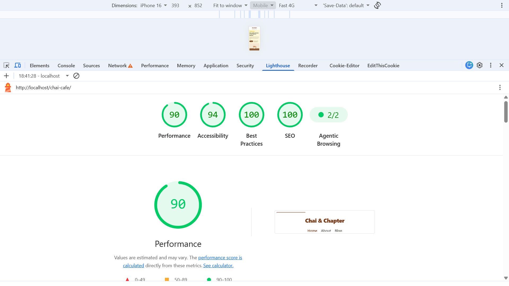

# ☕ Chai & Chapter Café

### Dynamic PHP & MySQL Website with SEO Optimization

**Chai & Chapter Café** is a dynamic, SEO-friendly website for a fictional café based in Mumbai, India. Built with PHP and MySQL, the website includes three main pages—Home, About, and Blog—with database-driven content and SEO metadata.

The project focuses on clean URL routing, technical SEO, semantic HTML, structured data, and search-engine-friendly architecture.

## ✨ Key Features

* **Dynamic Content Management:** Blog posts and page-specific SEO metadata are stored and retrieved from MySQL.
* **Three Main Pages:** Home, About, and Blog, with individual content and metadata.
* **Dynamic Blog System:** Dedicated pages for individual blog posts using SEO-friendly slugs.
* **SEO-Optimized Metadata:** Unique page titles, meta descriptions, and canonical URLs managed through the database.
* **Clean URL Structure:** Apache `.htaccess` and `mod_rewrite` provide readable URLs without unnecessary query parameters.
* **XML Sitemap:** Automatically generated from database content, including `lastmod` dates where available.
* **Robots.txt:** Provides crawler guidance and references the XML sitemap.
* **Custom 404 Pages:** Invalid blog slugs return an actual HTTP 404 response and include a `noindex` directive.
* **Semantic HTML:** Uses appropriate landmarks and a logical heading hierarchy for accessibility and content structure.
* **Structured Data:** Includes `CafeOrCoffeeShop` JSON-LD on the homepage, with business information, address, geographic coordinates, and opening hours.
* **Image Optimization:** Images include descriptive alt text and explicit width and height attributes to improve accessibility and reduce layout shifts.
* **Performance Testing:** Supports mobile performance audits through Google Lighthouse.

## 🛠️ Technology Stack

| Technology        | Purpose                                        |
| ----------------- | ---------------------------------------------- |
| PHP 8+            | Server-side application logic and routing      |
| MySQL / MariaDB   | Database for page metadata and blog content    |
| HTML5             | Semantic page structure                        |
| CSS3              | Styling and responsive layouts                 |
| Apache            | Web server and URL rewriting                   |
| JSON-LD           | Structured data for local business information |
| Google Lighthouse | Performance, accessibility, and SEO auditing   |

## 📁 Project Structure

```text
chai-cafe/
├── config.php
├── index.php
├── .htaccess
├── robots.txt
├── sitemap.xml
├── database/
│   └── schema.sql
├── pages/
│   ├── home.php
│   ├── about.php
│   ├── blog.php
│   └── single-post.php
├── includes/
│   ├── header.php
│   ├── footer.php
│   └── functions.php
├── assets/
│   ├── css/
│   ├── js/
│   └── images/
└── README.md
```

*Note: This is a suggested structure. Adjust the directory tree to match the actual project files.*

## 🌐 Website Routes

| Route          | Description                                 |
| -------------- | ------------------------------------------- |
| `/`            | Café homepage                               |
| `/about`       | Information about the café                  |
| `/blog`        | Blog listing page                           |
| `/blog/{slug}` | Individual blog post                        |
| `/sitemap.xml` | XML sitemap generated from database content |
| `/robots.txt`  | Search engine crawler instructions          |

## 🔍 SEO Implementation

### 1. Database-Driven Metadata

Page titles and meta descriptions are retrieved from the `pages` and `posts` tables, allowing each page to have its own SEO metadata.

### 2. Canonical URLs

Each page specifies a canonical URL to identify its preferred URL and help reduce duplicate URL issues.

### 3. SEO-Friendly Routing

Apache URL rewriting maps clean URLs to the appropriate PHP handlers without exposing unnecessary query parameters.

### 4. XML Sitemap

The sitemap includes eligible pages and published blog posts, with lastmod values when reliable modification dates are available.

5. Robots.txt

The robots file identifies the sitemap location and provides crawler instructions. It does not replace access controls or guarantee indexing behavior.

6. Structured Data

The homepage includes CafeOrCoffeeShop JSON-LD to describe the fictional café and its local business information.

7. Error Handling

Invalid blog slugs return an HTTP 404 status and a noindex directive, helping search engines distinguish missing content from valid pages.

🚀 Installation & Setup
Prerequisites
XAMPP or another Apache, PHP, and MySQL-compatible environment
PHP 8.0 or later
MySQL or MariaDB
Apache mod_rewrite enabled
Step 1: Copy the Project

Place the project folder inside your XAMPP htdocs directory.

Example:

C:\xampp\htdocs\chai-cafe
Step 2: Create the Database

Open the XAMPP Shell or Command Prompt and run:

mysql -u root < database/schema.sql

Run this command from the project directory. If your MySQL root account has a password, use:

mysql -u root -p < database/schema.sql

Alternatively, import database/schema.sql through phpMyAdmin.

Step 3: Configure Database Credentials

Open config.php and verify the connection settings:

define('DB_HOST', getenv('DB_HOST') ?: '127.0.0.1');
define('DB_NAME', getenv('DB_NAME') ?: 'chai_cafe');
define('DB_USER', getenv('DB_USER') ?: 'root');
define('DB_PASS', getenv('DB_PASS') ?: '');

These defaults match a typical local XAMPP installation where the root account has no password. Update them if your database credentials differ.

Security note: For production deployments, use environment variables and a dedicated database user with only the required permissions. Avoid exposing database credentials publicly.

Step 4: Configure Apache

Ensure mod_rewrite is enabled and that the Apache configuration permits .htaccess overrides for the project directory.

Step 5: Start XAMPP

Start Apache and MySQL from the XAMPP Control Panel.

Step 6: Open the Website

Visit:

http://localhost/chai-cafe/
🧪 Testing & Validation

Test the following before considering the project complete:

Home, About, and Blog pages load correctly.

Blog posts display the correct database content.

Every page has the expected title and meta description.

Canonical URLs point to the correct preferred URLs.

Clean URLs work without unnecessary query parameters.

Invalid blog slugs return HTTP 404.

/sitemap.xml contains the expected URLs.

/robots.txt references the correct sitemap location.

Structured data is valid and matches the displayed business information.

Images have suitable alt text and width/height attributes.

The layout works on mobile and desktop screens.

Database queries use appropriate parameterization to reduce SQL injection risks.

Lighthouse Audit
Open the homepage in Google Chrome.
Open Developer Tools → Lighthouse.
Select Mobile and run the audit.
Review Performance, Accessibility, Best Practices, and SEO results.
Save a screenshot of the results as:
lighthouse-home.png
Add the screenshot to the repository and link it in this README.

Example:

## 📊 Lighthouse Report



Only add the screenshot after running the actual audit. Do not claim a score that has not been measured.

🎯 Project Goals

This project demonstrates practical experience with:

PHP application development
MySQL database integration
Server-side routing and dynamic content
Technical SEO implementation
Semantic HTML and accessibility fundamentals
Structured data using JSON-LD
Apache configuration and local development with XAMPP
Website testing and performance auditing
📌 Future Improvements
Add an admin dashboard to manage pages, blog posts, and SEO metadata.
Implement secure authentication and role-based authorization.
Add blog categories, tags, and pagination.
Improve caching and database query performance.
Add automated tests for routing, metadata, and HTTP response codes.
Integrate Google Search Console after deployment.
Deploy the website using a production-ready PHP and MySQL hosting environment.

Project: Chai & Chapter Café
Category: Dynamic Website | PHP & MySQL | Technical SEO
Environment: XAMPP / Apache / PHP 8+ / MySQL
